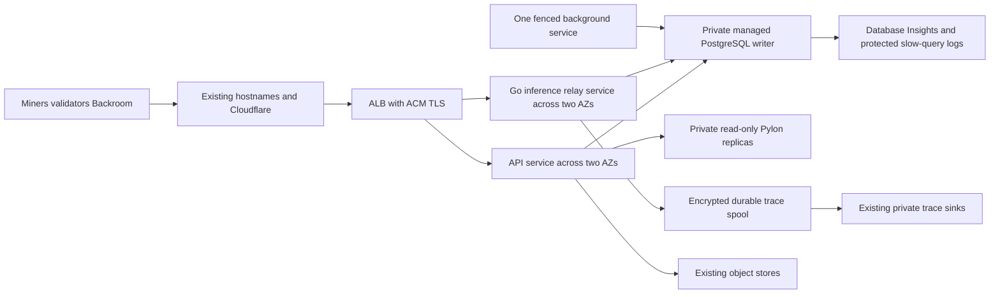

# Platform and PostgreSQL AWS migration plan

Prepared 13 November 2026. **Planning only: no resources, credentials, production settings, data or budgets were changed.** Prices are USD on-demand list prices in `us-east-1`, using 730 hours/month, before tax, credits or commitments.

## Recommendation and decision

Use **RDS PostgreSQL 17 Multi-AZ, `db.m7g.large`, 50 GiB gp3**, as the production cost baseline. It supplies managed backups and failover while keeping familiar PostgreSQL behavior. The current workload's hourly CPU averages are fairly steady, which weakens the case for paying more for elastic compute. Start storage autoscaling with a 200 GiB ceiling. RDS storage autoscaling grows disk capacity. Resizing database CPU or RAM remains a deliberate operation.

Choose **Aurora PostgreSQL Serverless v2** instead if automatic DB compute scaling and CloudWatch's native execution-plan view justify the premium. Price a writer plus a reader in another AZ, initially 2–8 ACUs each, with promotion tier 1 for the reader. The 2-ACU average scenario is a hypothesis to test: each instance has roughly 4 GiB at that capacity, versus the source DB host's 8 GiB. The comparison also prices 4 ACUs per instance, roughly matching that memory. ACUs are not a fixed vCPU equivalence. Keep production warm; existing persistent pools and continuous activity make scale-to-zero a poor cost assumption. [Aurora capacity](https://docs.aws.amazon.com/AmazonRDS/latest/AuroraUserGuide/aurora-serverless-v2.setting-capacity.html), [auto-pause constraints](https://docs.aws.amazon.com/AmazonRDS/latest/AuroraUserGuide/aurora-serverless-v2-auto-pause.html), [RDS storage autoscaling](https://docs.aws.amazon.com/AmazonRDS/latest/UserGuide/USER_PIOPS.Autoscaling.html).

Use ECS Fargate for the application services across two AZs. Scale the API and inference relay separately, and keep one controlled background service. Implement the packaging and lifecycle gates below before deploying this target. Keep schema cleanup, retention changes, a major PostgreSQL upgrade, object-store migration and new competition behavior in separate work.

| Production option | DB and DB Insights/month | Whole AWS Platform/month, planning traffic | With 25% contingency |
| --- | ---: | ---: | ---: |
| RDS Multi-AZ, 2 vCPU/8 GiB primary plus standby | $280.51 | **$877.23** | **$1,096.54** |
| Aurora Standard, writer + reader averaging 2 ACUs each | $375.57 | **$972.30** | **$1,215.37** |
| Aurora Standard, writer + reader averaging 4 ACUs each | $735.10 | **$1,331.82** | **$1,664.78** |

The existing $150/month AWS alert budget is insufficient for any complete configuration here. A budget alert is not a spending cap. These totals cover the proposed AWS compute/DB/network footprint; retained GCP services, object stores, screeners, validators, provider inference charges and engineering time remain additional. Approve a revised cost envelope and deployment scope after the pilots, before provisioning production or moving credentials.

## Current production evidence

The source assessment is pinned to monorepo `e9fb2057db2f638495309622b61768f1b6b89387`, with read-only cloud observations on 13 November. [baseline.json](baseline.json) preserves the aggregate measurements; it contains no SQL text, customer rows or credential material.

| Item | Observed state | Migration implication |
| --- | --- | --- |
| Application | `ditto-platform-prod`, GCE `e2-standard-4`, 4 vCPU/16 GiB, 100 GiB boot disk | Replace host deployment with immutable task images; build assets before deployment |
| PostgreSQL | Separate private `ditto-pg-platform`, `e2-standard-2`, 2 vCPU/8 GiB; 100 GiB boot + 50 GiB attached disk | PGDATA/WAL are configured on boot storage; attached capacity is not the DB size |
| Shared DB host | Both `ditto_platform_prod` and `ditto_platform_dev` | Move prod first; retain dev and do not count the shared host as a saving |
| Prod database | PostgreSQL 17.11, 23,286,060,723 bytes, about 21.7 GiB | Start with 50 GiB of priced storage headroom |
| Extensions | `pg_stat_statements` 1.11, `pgcrypto` 1.3, `uuid-ossp` 1.1, `vector` 0.8.0 | Rehearse extension/schema/version and vector-index compatibility on both targets |
| Largest relation | `inference_requests`, about 18.6 GiB including indexes, about 51 million estimated live rows | Restore/index time and query tuning matter more than raw DB size alone |
| Connections | `max_connections=100`, `shared_buffers=2GB`; roughly 20–22 connections in earlier samples | Budget maximum pools across services and rolling overlap; observed idle-in-transaction ages were short |
| Replication | `wal_level=replica`, 10 replication slots | CDC requires logical-WAL enablement and a restart affecting the shared dev/prod server |
| Query statistics | Statistics reset 8 September; I/O timing counters were zero | Historical totals are not recent rates, latency percentiles or measured I/O latency |

Seven-day Cloud Monitoring samples ending around 14:02 Eastern on 13 November contain 168 hourly CPU means per host. App CPU median/p95/max hourly mean: **31.5% / 38.1% / 44.7% of four vCPUs**. Shared DB: **34.5% / 43.7% / 48.6% of two vCPUs**. These smooth short spikes and include dev on the DB host; collect one-minute peaks and memory working set before final sizing.

Guest network totals were about **444 GB sent / 2,746 GB received** on the app and **2,428 GB sent / 188 GB received** on the DB over the sampled week. Much of this is internal DB traffic. These counters cannot directly determine internet, NAT, per-AZ or provider-billed traffic. They do establish that a tiny transfer allowance would be unsafe. The cost scenarios below deliberately separate those inputs. GCE disk operations likewise cannot be converted directly into Aurora billable I/O.

Live RDS APIs confirmed PostgreSQL 17.11 `db.m7g.large` gp3 supports Multi-AZ and storage autoscaling in this region; Aurora PostgreSQL 17.11 also advertises Serverless v2. Aurora's extension matrix lists pgvector 0.8.2 for 17.11, so a restore is not an exact extension-version clone of the source. Validate both forward and reverse restores before selection. [Aurora extension matrix](https://docs.aws.amazon.com/AmazonRDS/latest/AuroraPostgreSQLReleaseNotes/AuroraPostgreSQL.Extensions.html).

Owning source anchors:

- [GCP infrastructure and daily snapshots](../../infra/terraform/stacks/gcp-platform/main.tf), [prod host configuration](../../infra/ansible/host_vars/ditto-platform-prod.yml).
- [API, warm standby, Go relay slots and cleanup job](../../apps/platform/scripts/ecosystem.config.js), [singleton background-loop controls](../../apps/platform/ditto/api_server/factory.py), [DB pools](../../apps/platform/ditto/db/factory.py).
- [Deployment and relay release workflow](../../.github/workflows/platform-deploy.yml), [local-only DB versus deployed Pylon](../../apps/platform/docker-compose.yml).
- [Durable inference trace spool](../../services/model-relay/internal/traces/spool.go), [relay drain bound](../../services/model-relay/internal/server/server.go), [GCE watchdog metric publisher currently on the app host](../../infra/ansible/roles/screening_queue_metric/templates/publish-screening-queue-depth.py.j2).

## Managed application target



Baseline Fargate Linux/x86 task shapes, all pricing assumptions to validate under replay:

| Service | Desired count | Per task | Scaling and lifecycle |
| --- | ---: | --- | --- |
| Python API | 2 | 1 vCPU, 3 GiB | 2–4, background tasks false; scale on CPU and request latency/load |
| Go inference relay | 2 | 0.5 vCPU, 1 GiB | 2–4; scale independently on in-flight work and CPU; preserve long streams |
| Singleton/background API process, outside public target group | 1 | 0.5 vCPU, 2 GiB | Background tasks true; no horizontal scaling; stop-old/start-new until database fencing exists |
| Read-only Pylon | 2 | 0.25 vCPU, 1 GiB | One per AZ; private discovery; no validator wallet mounted |

This is 4 vCPU and 12 GiB in total, **$157.14/month** at baseline. All task sizes are valid Fargate combinations. Use x86 initially because the pinned Pylon image is amd64; RDS Graviton does not require ARM application images. [Fargate prices](https://aws.amazon.com/fargate/pricing/), [task sizes](https://docs.aws.amazon.com/AmazonECS/latest/developerguide/task_definition_parameters.html).

Implementation gates before this becomes a deployable service:

1. Package exact-release Python/dashboard and Go relay images in ECR. Run Alembic once from a protected migration task, never in every autoscaled API task. Preserve one schema head and immutable image/commit identity.
2. Separate singleton loops using existing `DITTO_PLATFORM_BACKGROUND_TASKS`; enforce one live owner through deployment transitions and failure recovery. Discovery is explicitly unsafe to run twice today. Desired count 1 alone does not fence overlapping ECS deployments or partitions.
3. Keep inference traffic off the Python control-plane event loop. Preserve every hostname, OAuth callback, signed-grant proxy URL, upload limit, forwarded-client rule and streaming contract.
4. Use two private task subnets, two NAT gateways with AZ-local routes, a private DB subnet group, security-group-only DB ingress, TLS with CA/hostname validation, and task-role/OIDC identities. S3 gateway endpoints avoid NAT for same-region S3 layers/objects; interface endpoints are not silently assumed free.
5. Preserve the relay's fsync/rotation/recovery contract with encrypted EFS access points or an equally durable tested spool. The model reserves $30/month for spool storage/throughput. Do not replace it with disposable Fargate storage. Verify concurrent recovery, upload retry and task replacement without trace loss or exposure; size from observed spool throughput/backlog.
6. Set ALB idle and deregistration timeouts for actual stream bounds. Fargate `stopTimeout` tops out at 120 seconds, while ordinary relay drain can be 125 seconds and the coding profile allows 305 seconds. Rehearse deregistration-before-stop with long streams and receipt settlement; block Fargate cutover if any supported path truncates. Keep an ECS/EC2 or controlled pre-drain alternative until proved. [ECS draining](https://docs.aws.amazon.com/AmazonECS/latest/developerguide/load-balancer-connection-draining.html), [task lifecycle](https://docs.aws.amazon.com/AmazonECS/latest/developerguide/task-lifecycle-explanation.html).
7. Move the app-host GCE watchdog publisher and scheduled image cleanup explicitly. The former must keep publishing under the existing policy/fencing rules even after the GCE app stops; test the independent watchdog against real backlog. Preserve the external capacity controller and scorer endpoints.
8. Inventory GCP Pub/Sub treasury-manual processing, archive RPC, GCS interop storage, Hippius/Backblaze, OAuth and provider secrets. Keep custody/signing on its current isolated path. Moving app credentials requires approved service-specific federation or secret migration; copying workstation keys or whole `.env` files is not a migration strategy. Existing stores remain authoritative in this phase, with their ongoing bills retained.

Connection budget at the planned scaling ceiling: 4 API tasks × 8 + 4 relays × 8 + singleton 8 + migration/cleanup 8 = **80 ordinary connections**. Reserve at least 20 for operations and deployment overlap, then verify the exact target's effective limit. Roll API and relay services separately, or lower pools, so simultaneous old/new tasks cannot exceed the budget. Do not route consistency-sensitive queries to an Aurora reader merely because it exists. RDS Proxy is optional and excluded until pool/churn evidence justifies its cost.

## Aurora versus RDS

| Concern | RDS PostgreSQL Multi-AZ instance | Aurora PostgreSQL Serverless v2 |
| --- | --- | --- |
| Compute scaling | Fixed instance class; resizing may cause interruption | Automatic within configured ACU range; storage, transfer and other charges remain outside that bound |
| Storage | gp3 provisioned capacity; autoscaling grows but does not shrink | Storage grows with data; billed storage and I/O depend on configuration |
| Availability | Primary plus synchronous, non-readable standby | Distributed storage plus explicitly priced reader in another AZ for compute failover |
| PostgreSQL portability | Closer to self-managed PostgreSQL, with managed-service privilege restrictions | PostgreSQL-compatible with Aurora-specific parameters and extension packaging |
| Query visibility | DB load, top SQL, waits, locks and slow logs with Advanced mode | Same, plus native CloudWatch execution-plan view for supported versions/settings |
| Costs and workload | Predictable base; good starting point for current steady load | Attractive when capacity varies enough, or elastic headroom/native plans are worth the premium |

Both require extension, collation/locale, index, privilege, SQL, asyncpg and failover tests. Neither grants unrestricted PostgreSQL superuser or makes inefficient queries cheap. A single Aurora writer has multi-AZ storage durability but is not the same compute-availability design as writer plus reader. [RDS availability](https://aws.amazon.com/rds/features/multi-az/), [Database Insights features](https://docs.aws.amazon.com/AmazonCloudWatch/latest/monitoring/Database-Insights.html).

### Database costs

| Monthly component | RDS Multi-AZ | Aurora Standard 2+2 average ACUs | Aurora Standard 4+4 average ACUs |
| --- | ---: | ---: | ---: |
| Compute | $246.01 | $350.40 | $700.80 |
| 50 GiB storage | $11.50 | $5.00 | $5.00 |
| Database Insights Advanced | $18.25 | $9.12 | $18.25 |
| 50 million Aurora I/Os, scenario input | Included gp3 baseline | $10.00 | $10.00 |
| 50 GiB backup beyond included allowance | $4.75 | $1.05 | $1.05 |
| **DB total** | **$280.51** | **$375.57** | **$735.10** |

RDS Multi-AZ rate $0.337/hour and gp3 $0.23/GiB-month already include the standby; do not double those SKU rates. Advanced monitoring models one 2-vCPU DB instance; retain $18.25/month additional billing headroom if the final monitored configuration meters another two CPUs. Aurora includes monitoring for both instances. Backup allowances model chargeable excess, not a charge for the entire retained backup set.

Aurora Standard is $0.12/ACU-hour; the current Price List API quotes I/O-Optimized at **$0.16**, versus $0.156 in a website example. Use the captured API rate. At 2+2 average ACUs and 50 GiB, I/O-Optimized costs **$488.62/month** and breaks even around **615 million billable I/Os/month**, keeping other inputs fixed. Begin with Standard unless measured Aurora I/O crosses that threshold. At a sustained 8+8 ACUs, compute plus Advanced alone would be **$1,438.10/month**, before common Platform costs; monitor capacity and cost forecasts. [Aurora pricing](https://aws.amazon.com/rds/aurora/pricing/), [RDS pricing](https://aws.amazon.com/rds/postgresql/pricing/), [monitoring pricing](https://aws.amazon.com/cloudwatch/pricing/).

For comparison only, a Single-AZ RDS DB is $151.39/month and a single Aurora writer averaging 2 ACUs is $195.81/month under these inputs. They are cheaper availability profiles, not equivalent replacements for the recommended HA designs.

### Whole Platform cost and traffic uncertainty

| Common monthly component | Planning assumption | Cost |
| --- | --- | ---: |
| Fargate services | Shapes above, steady baseline count | $157.14 |
| ALB | 730 hours, average 4 LCUs | $39.78 |
| NAT gateway hours | Two AZs | $65.70 |
| Public IPv4 | Two ALB addresses + two NAT EIPs, minimum assumption | $14.60 |
| NAT processed bytes | 2,500 GB, both directions combined | $112.50 |
| Internet data out | 1,000 GB, gross rate without shared free allowance | $90.00 |
| Cross-AZ DB/app allowance | 5,000 GB at $0.01 per charged-side GB | $50.00 |
| Durable trace spool | Storage and throughput allowance | $30.00 |
| Application/slow logs and Enhanced Monitoring | Bounded ingestion/retention allowance | $20.00 |
| Secrets / KMS / metrics and alarms | $8 / $2 / $4 | $14.00 |
| ECR / staging and small scheduled jobs | $1 / $2 | $3.00 |
| **Common subtotal** | Before selected DB | **$596.72** |

Rates include NAT $0.045/hour and $0.045/GB, ALB $0.0225/hour plus $0.008/LCU-hour, and IPv4 $0.005/address-hour. Public internet allowance uses $0.09/GB; actual free allowances, Cloudflare paths and origin charges may reduce it. Cross-AZ charging depends on the final service path: double that $50 line if two ends are chargeable. AWS-managed DB replication charges are already represented in the DB design, not added as application NAT traffic. [VPC](https://aws.amazon.com/vpc/pricing/), [ALB](https://aws.amazon.com/elasticloadbalancing/pricing/), [data transfer](https://aws.amazon.com/rds/pricing/), [EFS](https://aws.amazon.com/efs/pricing/).

| Traffic case | Internet out / NAT / cross-AZ GB; LCUs | RDS Multi-AZ total | Aurora 2+2 total | Aurora 4+4 total |
| --- | --- | ---: | ---: | ---: |
| Low | 100 / 250 / 1,000; 1 | $637.46 | $732.53 | $1,092.05 |
| Planning | 1,000 / 2,500 / 5,000; 4 | $877.23 | $972.30 | $1,331.82 |
| High traffic | 2,000 / 5,000 / 10,000; 8 | $1,153.09 | $1,248.16 | $1,607.68 |

These are scenario envelopes, not probability forecasts; high traffic does not include application scale-out or higher Aurora ACUs. An extra API task costs about $39.28/month continuously, an extra relay about $18.02. At the 4-API/4-relay ceiling, application compute adds about $114.61/month. A 1-TB increase in internet data out adds about $90, and 1 TB of NAT processing adds $45. Review CUR/cost allocation tags and byte attribution in the pilot before approving the recurring envelope.

Baseline GCP **compute only**, at public Iowa on-demand rates, is approximately $97.84/month for the app and $48.92/month for the shared DB VM. This is not the current invoice: disks, snapshots, NAT, networking and other services are additional. Retiring the prod app saves its compute only after acceptance; moving prod does not eliminate the dev/shared DB bill. Existing GCS/Hippius usage and model spend do not disappear. [GCP compute rates](https://cloud.google.com/products/compute/pricing/general-purpose).

Reproduce every estimate without credentials or cloud calls:

```bash
python3 docs/aws-platform-migration/cost-model.py
```

[cost-inputs.json](cost-inputs.json) captures SKU, rate, publication date, assumptions and allowances. The model performs no provisioning and no provider API calls.

## Slow query monitoring and optimization

Enable **CloudWatch Database Insights Advanced** on the chosen DB, along with engine log export and Enhanced Monitoring. Confirm the API's required Performance Insights enablement/retention settings against the selected engine; configure at least the required 465-day retention where that prerequisite applies. Standard mode is useful for top SQL/DB load but does not satisfy the requested slow-SQL, detailed lock and per-query statistics workflow. Advanced charges are already in the DB table; logs and OS telemetry are in the separate $20 allowance.

| Signal | Initial configuration and use |
| --- | --- |
| DB load and top SQL | Group by normalized query, wait event and application; compare load with available CPU; retain query statistics through restarts/changes |
| Slow statements | Start with `log_min_duration_statement=1000` ms, `log_lock_waits=on`, and parameter-value logging disabled; tune after volume/overhead measurement |
| Application attribution | Distinct `application_name` for API, relay, singleton, cleanup and migrations; request ID in application traces, never credentials or raw provider bodies |
| Aggregate query statistics | Enable `pg_stat_statements` through the parameter group and extension; collect interval deltas for calls, total/mean duration, rows, blocks and spills rather than treating lifetime totals as current load |
| Aurora plans | `aurora_compute_plan_id=on`; native estimated plans in Advanced. Enable `aurora_stat_plans.with_analyze` only after isolated overhead/SQL-sensitivity review |
| RDS PostgreSQL plans | Use restricted, bounded `EXPLAIN (ANALYZE, BUFFERS)` on a replica/replay where possible; do not promise Aurora's native CloudWatch plan tab. Avoid executing unknown or expensive statements in production merely to get a plan |
| Alarms | API errors/latency, stale heartbeat/queue age, CPU >70% for 15 min, connections >80% of usable budget, lock waits/deadlocks, storage <20%, backup freshness, Aurora capacity near ceiling, trace backlog/drops and cost forecast |

Slow SQL and execution plans can expose literals even when bind-value logging is disabled. Use KMS encryption, restricted SQL-text IAM, 30-day log-group retention initially, and no SQL text or trace bodies in public dashboards/issues. Keep complete inference trace sinks separate from CloudWatch operational logs. Validate with synthetic benign slow/lock queries and confirm that operator dashboards show the query and alarm without exposing credentials. [Database Insights](https://docs.aws.amazon.com/AmazonCloudWatch/latest/monitoring/Database-Insights.html), [execution-plan prerequisites](https://docs.aws.amazon.com/AmazonCloudWatch/latest/monitoring/Database-Insights-Execution-Plans.html), [RDS considerations](https://docs.aws.amazon.com/AmazonRDS/latest/UserGuide/USER_DatabaseInsights.Considerations.html).

Optimization loop: rank by interval total DB time and lock impact, inspect row estimates/index use/spills, reproduce on a production-sized isolated restore, then make one change with a before/after query and request-latency comparison. Start with `inference_requests` access patterns and retention requirements, but do not delete history, declare bloat, or add indexes from table size alone. Measure performance at low Aurora capacity as well as burst capacity so autoscaling does not hide a regression.

## Migration phases and one-time budget

Allow **8–12 engineer-days** for one selected DB target, application packaging, integration, rehearsals and cutover. Confirm the delivery date after the pilot resolves the lifecycle gates. A CDC path adds roughly **2–4 days** for source restart, identity/type checks and replication operations. No hourly labor rate was provided; labor cost is `days × 8 × loaded hourly rate`, separate from cloud charges.

| Phase | Work and exit condition | Indicative effort |
| --- | --- | --- |
| 1. Baseline and design | One-minute peaks, memory working set, DB/object traffic attribution, extension/locale and all-writer inventory; choose availability and budget | 1–2 days |
| 2. Isolated DB pilots | Same schema/data volume on short-lived RDS and Aurora; vector/index/SQL, restore time, query latency, failover and Insights comparison | 2 days |
| 3. AWS application target | Protected IaC plan/apply, OIDC/task identities, separate services, singleton fence, pools, durable traces and long-stream drain | 3–4 days |
| 4. Full rehearsal | Reproduce freeze/export/restore/validation and reverse recovery; no live scoring, payments or automatic work on the clone | 1–2 days |
| 5. Cutover and acceptance | Scheduled window, drain, final migration, one writer, functional acceptance and 24–72h observation | 1–2 days |

Request a **$300 one-time AWS rehearsal allowance**, separate from recurring production authorization. Illustrative allocation: 48h RDS Single-AZ pilot about $10; 48h Aurora writer averaging 4 ACUs about $24; 48h shared app/network harness roughly $40 before variable transfer; 96 temporary recovery-DB hours about $19; encrypted transfer/staging/logs about $25; remaining allowance covers repeated restore/index runs, traffic and controlled failover. Destroy only task-owned temporary resources after retaining evidence and required snapshots. The allowance is not approval to incur it.

For a 14-day GCP rollback hold, current app+shared-DB **compute** is roughly $67.55, plus retained disks/network/snapshots. Those existing GCP charges continue during the hold. The new AWS production design running for the same 14 days is roughly $404 with RDS or $448 with Aurora at 2+2 average ACUs under planning traffic. Those AWS days are already part of the monthly estimate. [Captured rates](cost-inputs.json).

### Preferred first migration: rehearsed write-freeze export and restore

Use a consistent PostgreSQL 17 directory/custom-format dump and parallel restore into a fresh target DB. Scope to prod only; pre-create supported extensions and remap ownership/grants rather than restoring superuser roles. Encrypt the dump, use restricted temporary access and expiry, and never stage production data on a shared Boat builder or workstation. Production-sized rehearsal belongs in explicitly approved, isolated cloud infrastructure.

Plan a **60–120 minute maintenance target after active work drains**. The actual window must be at least the measured final export + transfer + restore/index-build + validation time, with margin. At 51 million rows, index building can dominate. Abort/reschedule if rehearsal cannot meet the accepted window; this size alone does not prove a short outage. This path needs no source logical-WAL restart and no DMS service.

### Lower-downtime alternative: full load plus CDC

If the freeze window is unacceptable, enable logical WAL and a restricted replication identity in a separately approved shared-host maintenance window. Use native PostgreSQL logical replication or DMS only after testing every table's replica identity, vector/user-defined types, partitions, large objects, triggers and schema changes. Freeze DDL during replication. DMS is not assumed to transparently copy extensions or all PostgreSQL types. Sequences and schema DDL require explicit final synchronization. [PostgreSQL restrictions](https://www.postgresql.org/docs/17/logical-replication-restrictions.html), [DMS source requirements](https://docs.aws.amazon.com/dms/latest/userguide/CHAP_Source.PostgreSQL.html).

Indicative CDC target is a **10–20 minute final write freeze**, conditional on caught-up replication and a completed rehearsal. It is not zero downtime. A seven-day Single-AZ DMS `t3.medium` at $0.0745/hour is **$12.52 compute**, with storage/CPU-credit/transfer charges extra. For a fully redundant AWS/GCP VPN peer, model two AWS connections at an assumed $0.05/hour each and four GCP Iowa tunnels at $0.05/hour: **$50.40 for seven days**, plus AWS tunnel IPv4 and intercloud transfer. The AWS published example quotes Ohio; re-query the Virginia VPN SKU before purchase. Reserve **$150 incremental** for a bounded CDC rehearsal including DMS, VPN, IPs, storage and transfer, instead of treating connectivity as free. More traffic or a longer hold needs a revised envelope. A source restart affects both dev and prod. Tear down temporary connectivity only after rollback needs end; no public Postgres exposure is permitted. [AWS VPN pricing](https://aws.amazon.com/vpn/pricing/), [GCP VPN pricing](https://cloud.google.com/vpn/pricing).

## Cutover procedure and acceptance

1. Approve the selected target, recurring and rehearsal envelope, credential/federation changes, recovery objectives and maintenance window. Freeze unrelated schema/releases and record the exact source/target versions, extension matrix and accepted Alembic head. Keep old infrastructure and provider access intact.
2. Prove the isolated target can restore and reverse-restore, load vector indexes, connect with TLS, run representative queries, fail over, display slow SQL and retain durable traces. Clone background loops, external sends, treasury handling and automatic workload claims remain disabled or use isolated endpoints.
3. Deploy AWS tasks behind a private/test route with no production background owner. Use the same release as GCP. Capture source financial ledger, payment-proof identities, scores/tickets, queue counts and data checksums/manifests without exposing row contents publicly.
4. Pause new work and fee quotes deliberately; keep heartbeats and completions working while active leases/streams finish. Do not force-expire legitimate work to meet the window. If it will not drain by the agreed deadline, postpone. Stop prod singleton/cleanup writers and then apply a **database-scoped source write fence**, drain remaining prod sessions and verify a negative write probe for every prod principal. Dev must remain available. Design that fence from the actual role inventory; disabling a shared login blindly would affect dev.
5. For dump/restore, take the final consistent dump only after the fence. For CDC, wait for the recorded final source position, synchronize sequences and validate row/key counts, constraints, extension/locale behavior, ownership and the accepted migration head. Validate full counts/checksums during the isolated rehearsal; bounded production checks must fit the maintenance window.
6. Start exactly one AWS background owner, enable the new writer, and switch the existing hostnames without changing signed proxy URL values. Fence the old origin so stale DNS cannot continue writing. Preserve receipt/payment/submission IDs and idempotency state; no migration test should require charging the same submission again.
7. Exercise upload admission with an already-authorized test or genuine submission, screener claim/heartbeat/verdict, validator ticket/score settlement, inference streaming/receipts, Backroom permissions, dashboards, OAuth, object downloads, trace shipping and epoch/background behavior. Verify the watchdog publisher and capacity controller against the new endpoint. Use real client paths, not `/health` alone.
8. Observe 24–72h against measured source SLOs, with alarms and cost attribution. Proposed stop conditions: sustained >1% unexpected 5xx for five minutes, p95 latency >20% above the agreed comparable-load baseline for 15 minutes, failed accounting/idempotency checks, stale lease/epoch processing, trace loss or a breached cost envelope. Record a deliberate rollback or roll-forward decision; never switch databases automatically.
9. Retain GCP for at least the agreed 14-day rollback hold and a successful managed-backup restore drill. Retire the prod app only after its watchdog, cleanup and credential dependencies are removed. Keep dev/shared PG until a separately approved dev migration; no deletion or cancellation is part of this planning PR.

## Recovery and rollback

Target objectives below require rehearsal evidence before they become commitments. Enable encrypted automated backups/PITR with 14-day retention, deletion protection and a final snapshot requirement on either target. Retain the existing independent encrypted backup path until a managed-DB-compatible replacement and restore test passes. Start with an isolated restore before cutover, repeat monthly, and alert on backup/restore age. A same-region managed backup is not a full region-disaster plan.

| Failure or phase | Recovery action | Proposed objective |
| --- | --- | --- |
| API/relay release regression after DB cutover | Deploy previous immutable application image against the **same AWS authoritative DB**, preserving schema compatibility; controlled singleton handoff | RTO ≤15 min; no intentional DB write loss |
| DB instance/AZ failure | Managed failover, retry/reconnect with bounded backoff and idempotent settlement; validate endpoint refresh and pool replacement | Target ≤5 min; no intentional loss of acknowledged commits for the tested HA failure mode |
| Before AWS accepts production writes | Keep target fenced, revert routing to GCP and lift the source fence only after all AWS writers are stopped | Target ≤15 min after abort decision; source remains authoritative |
| After AWS accepts production writes, target still readable | Freeze/drain AWS writers, export its latest authoritative state, restore into a **fresh isolated recovery DB**, validate, then repoint a compatible app and establish one writer | Target 2–4h after rehearsal; zero intentional committed-write loss through the recorded fence |
| Logical corruption | Restore PITR to a new DB, inspect affected interval and reconcile externally acknowledged payments/scores before reopening | Target RTO 2–4h; latest recoverable point freshness ≤5min. A corruption-safe point can be older and reconciliation may take longer |
| Complete AWS region loss | Use independently retained backup and compatible app recovery, with a separately priced regional DR design | Not covered by the HA estimate; daily offsite export, if adopted, implies up to 24h data exposure without continuous replication |

**After the first AWS production write, DNS rollback to the stale GCP database is unsafe.** Retaining the old host does not keep its data current. A compute rollback should keep using the AWS DB. A database reversal must fence the current writer, carry forward all accepted state, and validate a fresh recovery target. Do not overwrite the shared GCP dev/prod cluster as a shortcut. Reverse restores must support the target extension versions, especially pgvector; preserve original and authoritative snapshots until the operator signs off.

PITR replays stored database state, not external blockchain/provider actions. Identify already-paid uploads and settled inference/score receipts after any recovery, reconcile the gap, and suppress replayed payments or duplicated settlements. If AWS is unavailable and no current authoritative export can be read, the zero-loss reversal objective does not apply: use the documented recovery point and explicitly reconcile the missing interval.

## Decisions required before implementation

- Choose RDS Multi-AZ as the cost baseline, or pay the measured Aurora premium for DB compute autoscaling/native plans. Keep a pilot-based escape hatch rather than purchasing a commitment now.
- Accept the rehearsed maintenance window or fund CDC plus its shared-host restart and private connection.
- Set the recurring envelope after traffic attribution: approximately $1,100 with contingency for RDS, $1,250 for a proven 2+2 Aurora average, or $1,700 for the 4+4 scenario; existing GCP/object/provider bills remain additional.
- Approve the $300 rehearsal ceiling, actual credential/federation movement, and cutover separately. This plan and PR authorize none of those operational mutations.
