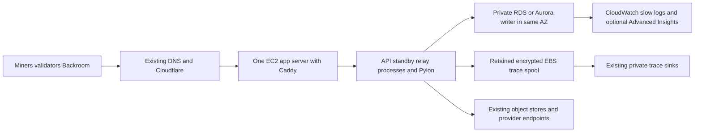

# Platform AWS migration with one app server and managed PostgreSQL

Prepared 13 November 2026. **Planning only.** The target is one app server, private managed PostgreSQL and slow-query monitoring. Production, credentials, cloud resources and budgets remain unchanged.

## Recommended starting point

Use one **EC2 `m6i.xlarge`**, Linux/amd64, 4 vCPU and 16 GiB, with a 100-GiB encrypted gp3 disk. Keep Caddy, the Python Platform API and warm standby, two Go relay processes, read-only Pylon, scheduled cleanup and the durable local trace spool on that server. Those are processes on one machine.

Pair it with **RDS PostgreSQL 17.11 `db.m7g.large`, Single-AZ, 2 vCPU/8 GiB and 50 GiB gp3**. Place the active DB and app in the same availability zone. Enable 14-day automated backups/PITR, deletion protection, a final-snapshot requirement, and storage autoscaling with an initial 200-GiB ceiling.

At the planning allowance of 300 GB/month internet data out, this is **$342.70/month**, including Database Insights Advanced, chargeable backup allowances, app storage/snapshots, one public IPv4 address and operational logging. A 15% contingency makes it **about $394/month**. Keep the recurring authorization near $400 only if the transfer/logging assumptions hold; alerts do not enforce a hard bill cap.

The cheaper Aurora alternative below starts at a **$251.16/month warm-floor scenario**, with automatic compute scaling and log-based slow-query monitoring. Its minimum is not evidence that production will stay at that price.

All estimates use 730 hours/month, USD on-demand `us-east-1` rates, before tax, discounts, credits or shared free allowances. Retained GCP dev/rollback resources, existing object stores, model inference, screeners, validators and engineering time remain additional.

## Network and host layout



The app gets one Elastic IP and an internet-gateway route. It connects directly to approved external services and AWS APIs, so **no NAT gateway is required**. HTTPS remains terminated by Caddy behind the existing hostnames. Restrict ingress to the intended web paths, preserve proxy/client-auth behavior and certificate renewal, and use the instance role plus SSM for administration. No public SSH port or developer key transfer is needed.

The DB has `PubliclyAccessible=false`, private addresses and security-group ingress on PostgreSQL only from the app's security group. Validate TLS, CA and hostname verification in asyncpg and Go clients. Managed DB maintenance and backups do not require an app-owned NAT gateway. The DB subnet group still spans two private subnets/AZs, as RDS requires; an unused subnet does not create another DB instance or gateway charge. [AWS public-web/private-DB pattern](https://docs.aws.amazon.com/AmazonRDS/latest/UserGuide/USER_VPC.Scenarios.html).

Use private app-to-DB traffic in the same AZ to avoid a recurring cross-AZ DB transfer charge. Verify placement after restore/replacement. Keep one app VM and one DB writer in this phase. ALB, Fargate, EFS, NAT gateways, paid private endpoints, RDS Proxy and a second Aurora reader have **$0 allocation in this base design because none are being provisioned**. A same-region S3 gateway endpoint can be added without an hourly endpoint charge where useful.

Preserve the current operating model through Ansible and exact-release artifacts. Retain the app EBS volume on instance termination, ship completed traces to their existing private sinks, manage log rotation, and test reboot/instance-replacement recovery. EBS is AZ-local; a retained volume does not provide cross-AZ availability.

## Source workload and scope

The read-only source assessment is pinned to monorepo `e9fb2057db2f638495309622b61768f1b6b89387`. [baseline.json](baseline.json) records the 13 November inventory and seven-day aggregate telemetry, without SQL text, customer rows or credentials.

| Source | Observed state | Target implication |
| --- | --- | --- |
| Production app | GCE `e2-standard-4`, 4 vCPU/16 GiB, 100-GiB disk | Keep that nominal CPU/RAM/storage shape on amd64; validate actual performance |
| DB host | Separate private `e2-standard-2`, 2 vCPU/8 GiB; prod and dev databases | Move prod first; keep the dev dependency and its bill until separately migrated |
| Production DB | PostgreSQL 17.11; about 21.7 GiB | Start RDS at 50 GiB; Aurora model budgets 50 GiB of consumed storage |
| Extensions | `pg_stat_statements` 1.11, `pgcrypto` 1.3, `uuid-ossp` 1.1, `vector` 0.8.0 | Test the exact managed engine/extension matrix and forward/reverse restore |
| Largest table | `inference_requests`, about 18.6 GiB including indexes; about 51 million estimated rows | Rehearse index-build time and representative query latency |
| Source connections | `max_connections=100`; about 20–22 observed; shared buffers 2 GiB | Budget pools and deployment overlap; avoid copying a fixed 2-GiB buffer setting into a 1-GiB Aurora floor |
| Replication | `wal_level=replica`, 10 slots | CDC requires a separately planned restart affecting the shared dev/prod host |

App hourly CPU mean median/p95/max was 31.5% / 38.1% / 44.7% of four vCPUs; DB 34.5% / 43.7% / 48.6% of two. Hourly averages smooth short spikes and the DB includes dev. Use these measurements for initial sizing, then benchmark the target processors.

Guest network counters contain substantial internal DB traffic. Keep app and DB together in AWS; leaving the app on GCP and querying an AWS DB across clouds would add latency and transfer costs to that hot path. Internet and Aurora I/O charges remain explicit scenarios until metered on the pilot.

Owning source anchors:

- [Host services and pools](../../apps/platform/scripts/ecosystem.config.js), [API background ownership](../../apps/platform/ditto/api_server/factory.py), [DB connection factory](../../apps/platform/ditto/db/factory.py).
- [Current prod host configuration](../../infra/ansible/host_vars/ditto-platform-prod.yml), [GCP topology and snapshots](../../infra/terraform/stacks/gcp-platform/main.tf), [deployment workflow](../../.github/workflows/platform-deploy.yml).
- [Trace spool fsync/recovery](../../services/model-relay/internal/traces/spool.go), [relay graceful drain](../../services/model-relay/internal/server/server.go), [app-host GCE watchdog publisher](../../infra/ansible/roles/screening_queue_metric/templates/publish-screening-queue-depth.py.j2).

Actual GCP billing remains private and outside this public repository. The public-rate model for the current prod app plus shared DB is about $171.75/month in compute and disks, excluding dev-app, transfer, snapshots and other services. Do not compare that fixed-only number to an all-in AWS scenario or assume the shared DB disappears when only prod moves.

## RDS monthly cost

| Item | Rate or allowance | Monthly cost |
| --- | --- | ---: |
| One app VM, `m6i.xlarge` | $0.192/hour | $140.16 |
| App gp3 disk, 100 GiB | $0.08/GiB-month, included baseline IOPS/throughput | $8.00 |
| Incremental app snapshots | 50 chargeable GiB-month × $0.05 | $2.50 |
| One app public IPv4 | $0.005/hour | $3.65 |
| Internet data out | 300 GB × $0.09, gross allowance | $27.00 |
| App/slow logs, metrics and alarms | Small-volume operational allowance | $8.00 |
| Secrets and request charges | Allowance; AWS-managed encryption keys initially | $2.00 |
| RDS Single-AZ compute | `db.m7g.large`, $0.168/hour | $122.64 |
| RDS gp3 storage, 50 GiB | $0.115/GiB-month | $5.75 |
| Chargeable DB backup excess | 50 GiB-month × $0.095 | $4.75 |
| Database Insights Advanced | 2 vCPU × $0.0125/hour | $18.25 |
| **Total** | One app VM and one private managed DB | **$342.70** |

The app/operations subtotal before the selected DB is $191.31 with that transfer allowance. RDS itself is $151.39 with Advanced, or $133.14 using basic metrics, exported slow logs and query-statistics reads instead. The latter whole-system option is **$324.45/month** and still supports slow-query investigation, with fewer native Insights features.

CloudWatch's $8 operational allowance assumes roughly 10 GB/month log ingestion, short log retention and few custom metrics/alarms. Complete inference bodies stay in the existing private trace sinks. More logs, retained EBS data, paid KMS keys, transfer or API usage increase the bill. For example, another 10 GB of log ingestion adds roughly $5 before storage/query charges. Existing Cloudflare, GCS, Hippius/Backblaze and provider bills continue.

The refreshed EC2/EBS Price List API snapshots and the same-day DB/Insights rates are captured in [cost-inputs.json](cost-inputs.json). Sources: [EC2 prices](https://aws.amazon.com/ec2/pricing/on-demand/), [EBS](https://aws.amazon.com/ebs/pricing/), [RDS PostgreSQL](https://aws.amazon.com/rds/postgresql/pricing/), [CloudWatch](https://aws.amazon.com/cloudwatch/pricing/), [public IPv4](https://aws.amazon.com/vpc/pricing/).

### Remaining transfer uncertainty

| Internet out per month | One app + RDS Advanced | One app + Aurora at 0.5 average ACU, logs | One app + Aurora at 1 average ACU, logs | One app + Aurora at 2 average ACUs, Advanced |
| --- | ---: | ---: | ---: | ---: |
| 100 GB | $324.70 | $233.16 | $276.96 | $369.12 |
| **300 GB planning allowance** | **$342.70** | **$251.16** | **$294.96** | **$387.12** |
| 1,000 GB | $405.70 | $314.16 | $357.96 | $450.12 |

This prices actual internet output rather than all guest network bytes. Internet ingress and ordinary same-AZ private DB traffic are not modelled as paid internet/NAT transfer. The account-wide free data-out allowance is deliberately not assumed available. Attribute traffic on the pilot and update the allowance; this table is not a usage forecast.

## Lowest-cost Aurora option

Use **one Aurora PostgreSQL Serverless v2 writer, Aurora Standard, zero reader instances**, private in the app's AZ. Start the cheapest pilot with **0.5–4 ACUs** and exported slow logs plus `pg_stat_statements` and basic CloudWatch alarms. It retains automatic compute scaling while avoiding a second DB instance and the extra Insights instrumentation at the smallest capacity.

At an average of 0.5 ACU for the whole month, compute is **$43.80**. Adding the model's 50-GiB storage budget ($5), 50 million billable I/Os ($10) and 50-GiB chargeable backup excess ($1.05) makes **$59.85/month for the DB**, or **$251.16/month including the app and planning transfer allowance**.

| Aurora scenario | DB/month | Whole AWS target/month | Meaning |
| --- | ---: | ---: | --- |
| Fully paused all month, zero I/O | $6.05 | Do not use as a working-Platform quote | Storage/backup budget remains; app is still billed |
| 0.5 average ACU, log-based monitoring | $59.85 | $251.16 | Cheapest warm floor, about 1 GiB of memory at that capacity |
| 1 average ACU, log-based monitoring | $103.65 | $294.96 | Pilot cost hypothesis, about 2 GiB at that capacity |
| 2 average ACUs, log-based monitoring | $191.25 | $382.56 | About 4 GiB at that capacity |
| 2 average ACUs, Advanced Insights | $195.81 | $387.12 | Practical starting instrumentation profile to test |
| 4 average ACUs, Advanced Insights | $375.57 | $566.88 | About 8 GiB at that capacity; comparison with source memory |

**Average capacity determines compute charges.** A 0.5 minimum with long periods at 2–4 ACUs does not produce a $60 DB bill. The source has a 2-GiB shared-buffer setting alone, plus backends and other memory use. It cannot simply be copied onto a 1-GiB Aurora instance. Let managed parameters adapt, test realistic connections/queries, and raise the minimum if memory pressure, slow scale-up or I/O churn hurts latency. There is no fixed ACU-to-vCPU performance equivalence.

AWS recommends a **2-ACU minimum for Performance Insights**. For a native Advanced dashboard and Aurora execution-plan view, use a **2–4 ACU pilot**, not the cheapest log-only profile. At the same storage/I/O assumptions, the Advanced Aurora bill exceeds the RDS Single-AZ Advanced bill above roughly **1.506 average ACUs**, so this instrumented 2-ACU profile costs more than RDS. [Aurora capacity guidance](https://docs.aws.amazon.com/AmazonRDS/latest/AuroraUserGuide/aurora-serverless-v2.setting-capacity.html).

The absolute idle compute floor is **0 ACUs** on supported engines, with a configurable auto-pause idle interval. That does not make a live Platform free: persistent DB pools, background jobs and heartbeats prevent pause. Resuming can take around 15 seconds, or longer after a long pause. Reserve auto-pause for dev or a deliberate application redesign; do not include paused hours in the production budget before observing them. Aurora's actual consumed storage may be below the 50-GiB budget, but its distributed storage still bills while paused. [Auto-pause](https://docs.aws.amazon.com/AmazonRDS/latest/AuroraUserGuide/aurora-serverless-v2-auto-pause.html).

Aurora I/O is another variable: every additional 50 million requests adds $10 on Standard. Current GCE disk counters do not establish Aurora I/O volume. I/O-Optimized is not the lowest-cost choice at these inputs: it raises ACU and storage rates. Verify real I/O before considering it. [Aurora pricing](https://aws.amazon.com/rds/aurora/pricing/).

### Optional cheaper app VM

A `t3a.xlarge` keeps 4 vCPU/16 GiB and amd64 at **$109.79/month compute**, saving **$30.37/month before surplus CPU credits**. That would make the planning RDS/Advanced total **$312.33**, the 0.5-ACU Aurora floor **$220.79**, and the 1-ACU Aurora scenario **$264.59**.

T3a has a 40% CPU baseline, earned credits and either throttling or surplus charges depending on credit mode. Current hourly CPU averages make it worth testing, but they do not prove the same CPU utilization or zero surplus fees on a different processor. Keep the fixed-performance M6i in the main budget until a representative 48–72h test shows acceptable latency, memory and credit behavior. Alarm on credit balance and surplus-credit charges if selecting T3a. [CPU-credit rules](https://docs.aws.amazon.com/AWSEC2/latest/UserGuide/burstable-credits-baseline-concepts.html).

## Slow query monitoring

The default RDS option includes **Database Insights Advanced ($18.25/month)**, PostgreSQL log export and a small log/metric allowance. Configure required Performance Insights enablement/retention for the exact engine; where required, use at least 465 days. Standard Insights supplies top DB-load contributors, while Advanced adds the native slow-SQL, lock and detailed query-statistics experience. RDS PostgreSQL does not have Aurora's native CloudWatch execution-plan tab. [Feature matrix](https://docs.aws.amazon.com/AmazonCloudWatch/latest/monitoring/Database-Insights.html).

For both RDS and the cheapest Aurora profile:

- Enable `pg_stat_statements` in the supported parameter group/extension setup and collect interval deltas, not lifetime averages.
- Start slow-statement logging around 1,000 ms and lock-wait logging, with bind-value logging disabled. Export PostgreSQL logs to CloudWatch, initially retain them for 30 days, and use a saved Logs Insights view for slow statements and locks.
- Tag DB sessions through `application_name` for API, relay, jobs and migrations. Keep request correlation in protected application logs.
- Restrict SQL-text access. Statements and plans may contain literals even when bind logging is disabled; keep them out of public dashboards and PRs.
- Alarm on errors/latency, connections near the usable limit, disk space, CPU, backup freshness, trace-spool backlog/drops, stale leases/background loops and spend forecasts.

The lowest Aurora profile uses logs and direct statistics for investigation; it does **not** promise the Advanced slow-SQL/plan dashboard at its floor price. With Advanced Aurora, enable `aurora_compute_plan_id`; trial actual-plan collection only after measuring overhead. With RDS, use restricted and bounded `EXPLAIN (ANALYZE, BUFFERS)` on an isolated replay where possible. [Execution-plan prerequisites](https://docs.aws.amazon.com/AmazonCloudWatch/latest/monitoring/Database-Insights-Execution-Plans.html).

Rank queries by interval total execution time, locks and spills, then test one change against representative data and request latency. Validate monitoring with benign synthetic slow/lock queries on the pilot. Do not infer a retention policy or delete history from the size of `inference_requests`.

## Availability and operating tradeoffs

This design intentionally matches a single-server operating model. App process redundancy protects some restarts on the **same host**. It does not protect a host or AZ outage. Single-AZ RDS provides managed operations and recovery, without a warm standby in another AZ. A single Aurora writer has distributed durable storage but no warm reader to take over its compute.

Optional RDS Multi-AZ raises the DB estimate from $151.39 to $280.51, an increase of **$129.12/month** before any cross-AZ traffic. It does not make the one app server highly available. A second Aurora writer-sized reader similarly adds compute and monitoring. Keep both as explicit later decisions.

Keep the current one-owner background-loop behavior. PM2 rolls and cached rollback artifacts must preserve it; do not start a second background owner on the GCP rollback host. Budget DB pools across the main API, warm standby, both relays, cleanup/migration sessions and rolling overlap; the existing app's main/standby/relay maxima alone total 62. Leave operations headroom and validate the managed limit. The smallest Aurora capacity may need lower pools or a higher floor.

Retain long-stream drain bounds, trace fsync/rotation/retry, immutable Go relay artifacts, Caddy backups/validation and expected public proxy URLs. Rehearse reboot and EC2 stop/start before cutover. Preserve the image-cleanup schedule and GCE watchdog metric publisher that currently runs on the GCP app host, including its separately authorized GCP workload identity or replacement publisher. The capacity controller, dev DB, custody service and other workloads remain where they are until their own migration.

## Migration work and cost

Allow **5–8 engineer-days** for this narrower design: inventory and managed-DB compatibility, Ansible/CI adaptations, private network/identity setup, restore and monitoring trials, app recovery and cutover rehearsal. It reuses the host layout and avoids the Fargate packaging, singleton-service separation and EFS lifecycle work.

Propose a **$150 one-time rehearsal ceiling** for a short-lived app VM, isolated RDS/Aurora trials, repeated restore/index builds, snapshots, transfer and logs. At the captured rates, 48h of the default app is $9.22 compute, 48h of RDS is $8.06 compute, and 48h of an Aurora writer averaging 2 ACUs is $11.52 compute. Storage, monitoring and repeated runs consume the remaining allowance. This proposal does not authorize spending.

Implement the new resources in a dedicated subnet-owned Terraform root such as `infra/terraform/stacks/aws-platform`. Add that root to the existing reviewed-plan/protected-apply workflow with narrowly scoped CI OIDC and runtime roles. Use the established state bucket and ordinary `infra-apply` review, without an admin bypass or changes to its reviewer settings. Keep provisioning separate from application activation.

Extend the owning Ansible roles and AWS inventory for the EC2 host, managed DB TLS, CloudWatch agent/log rotation, backups, SSM and bounded read-only operations. Adapt the exact-release deployment workflow to this host while retaining signed artifact identity and Caddy/config backups. Resolve GCP workload federation and external secrets explicitly before moving their consumers; do not create standing keys to make the initial boot pass.

Use a fresh target DB with the exact source schema and tested extension/locale/ownership behavior. Aurora 17.11 currently packages pgvector 0.8.2 while the source uses 0.8.0, so validate reverse recovery as well as forward restore. Never stage production dumps or credentials on shared Boat builders or a workstation. Use an approved isolated migration runner and encrypted, access-limited temporary objects.

Prefer a rehearsed **write-freeze dump/restore**, with a provisional **60–120-minute maintenance target after active work drains**. Measure full export, transfer, restore, index build and validation before agreeing to the window. Keep prod schema and behavior unchanged. The 51-million-row table can make indexes dominate the elapsed time.

If that outage is unacceptable, price CDC separately. The source currently uses `wal_level=replica`; logical WAL needs a restart affecting dev and prod. Plan schema/sequence synchronization, table identities and extension/type handling. A seven-day DMS test is about $12.52 compute; a redundant four-tunnel GCP/AWS VPN example is about $50.40 in connection/tunnel hours before IPv4/transfer. Reserve **$150 additional** for that bounded option, verify regional VPN rates before purchase, and do not build a permanent cross-cloud app/DB dependency. [PostgreSQL replication limits](https://www.postgresql.org/docs/17/logical-replication-restrictions.html), [AWS VPN](https://aws.amazon.com/vpn/pricing/), [GCP VPN](https://cloud.google.com/vpn/pricing).

### Cutover acceptance

1. Approve the chosen DB/monitoring profile, cost envelope, actual credential/federation changes and maintenance window before provisioning or deploying. Use reviewed Terraform plans and protected applies; host state belongs in Ansible.
2. On an isolated restore, test vector indexes, representative queries, target memory/pools, TLS, backups/PITR restore, slow-query visibility, app reboot/replacement, signed routes, streaming and trace recovery. Disable real claims, external sends, treasury processing and duplicate background loops on the clone.
3. Pin one exact release on both clouds. Inventory GCS/Hippius/Backblaze, OAuth, RPC, treasury Pub/Sub and watchdog dependencies. Move only approved service-specific identities; no whole-`.env` or workstation-key copying.
4. Pause new admission/fee quotes, then let active leases, streams and completions drain while heartbeats remain live. Postpone if legitimate work cannot drain by the agreed deadline; do not force-expire it.
5. Stop prod background/cleanup writers. Establish a verified **database-scoped source write fence** and drain prod sessions while keeping dev available. Take the final consistent dump, or final CDC position, and validate restored counts/checksums, constraints, sequences, grants and the accepted Alembic head. Do not restore superuser roles blindly.
6. Start exactly one AWS background owner, establish the AWS writer and switch the existing hostnames. Fence stale GCP origins. Preserve payment proofs, submission/score/ticket IDs and settlement idempotency; migration retries must not charge a submission again.
7. Exercise authenticated uploads, screener claim/heartbeat/verdict, validator scores, inference streams/receipts, Backroom access, OAuth, object downloads, trace shipping, epoch jobs and the watchdog publisher against the new endpoint. Health alone is insufficient.
8. Observe 24–72h against agreed source SLOs and metered bytes/costs. Trigger a controlled rollback/roll-forward decision for accounting discrepancies, trace loss, stale work, unexpected 5xx >1% for five minutes, or comparable-load p95 latency >20% above baseline for 15 minutes.
9. Keep GCP available for an agreed 14-day rollback hold and a successful managed-DB restore drill. Moving prod does not retire the shared PG host needed by dev. Retire resources only after explicit owner approval and dependency removal.

## Rollback and recovery

| Failure or phase | Procedure | Rehearsal target |
| --- | --- | --- |
| App release regression | Roll back the cached exact application/relay/config release on EC2 against the **same authoritative AWS DB**; preserve one background owner | ≤15 min; no intentional DB write loss |
| App instance failure in its AZ | Recover/attach retained EBS or restore a tested snapshot to a replacement, converge roles, reattach the EIP and validate health plus real behavior | Target 30–60 min; DB state remains authoritative; local trace recovery depends on disk/sink state |
| Single-AZ DB or whole-AZ loss | Restore managed backup/PITR to a fresh DB and, if needed, rebuild the app in its AZ | Provisional 1–4h after rehearsal; latest-restorable-point freshness target ≤5 min, subject to actual backup availability |
| Abort before first AWS production write | Stop/fence all AWS writers, return routing to GCP, then lift the verified source fence | ≤15 min after abort decision |
| Reverse after AWS has accepted writes | Freeze/drain AWS, export its latest authoritative state, restore into a fresh compatible recovery DB, validate and then repoint a compatible app | Provisional 2–4h; no intentional committed-write loss if current authoritative data remains readable |
| Logical corruption | Restore a clean PITR point to a new DB and reconcile the affected external actions before reopening | A corruption-safe point can be older than the latest backup; recovery/reconciliation time depends on the incident |

After the first AWS production write, routing back to the old GCP DB would discard accepted writes. Retaining that host does not keep its data current. Application rollback keeps using AWS Postgres. Database reversal must carry forward accepted state and establish one writer; do not overwrite the shared dev/prod GCP cluster as a shortcut.

Preserve 14-day managed backups/PITR, deletion protection and final snapshots. Keep the existing independent encrypted backup path until a managed-compatible export and restore drill passes. Rehearse once before cutover and monthly afterward. Offsite daily exports, if chosen, have a different recovery point from PITR and do not supply continuous regional DR.

Blockchain payments and provider calls are external to PostgreSQL recovery. Reconcile already-paid uploads, delivered inference receipts and score settlements before replaying work. If the current AWS data is unavailable, do not promise zero-loss reversal; use the recorded recovery point and reconcile its gap.

## Reproduce and review

```bash
python3 docs/aws-platform-migration/cost-model.py
```

The offline model reads captured rates, assumptions, monitoring profiles and transfer scenarios from [cost-inputs.json](cost-inputs.json). It makes no cloud calls.

The first implementation decision is RDS Single-AZ with Advanced monitoring, or a cheaper Aurora log-only pilot whose **measured average ACUs** must justify it. The base RDS estimate is about $343; the lowest Aurora warm floor is about $251, with the same app and transfer allowance. An optional credit-qualified T3a app saves about $30. No provision/deploy, budget change, credential migration, destructive cleanup or retirement is authorized by this planning update.
